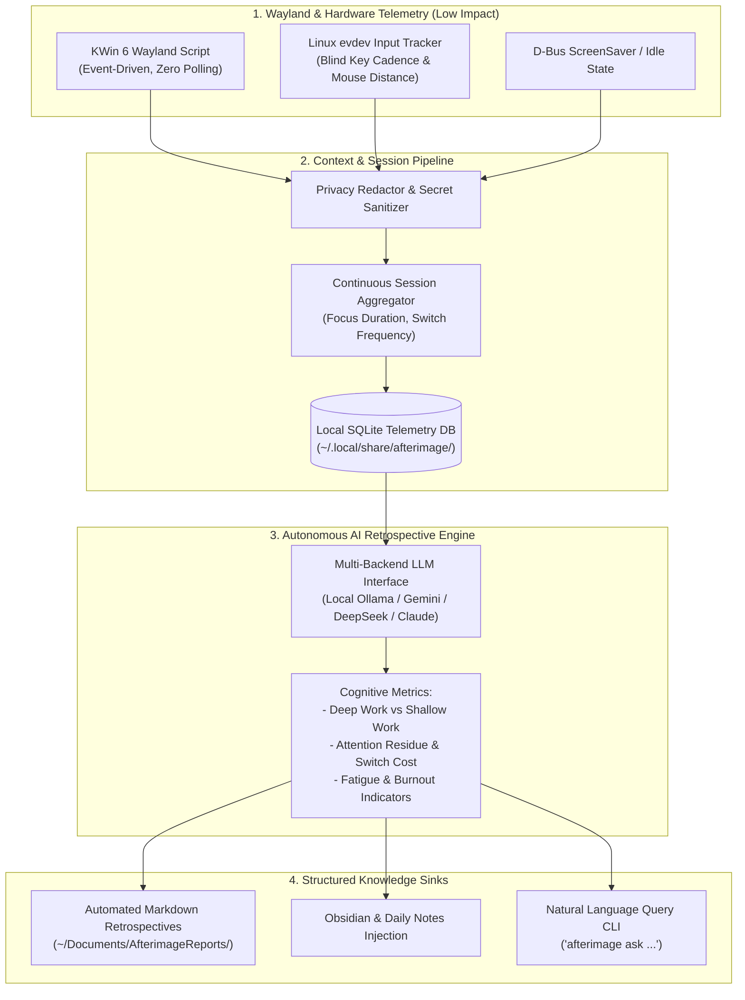

# Afterimage (残影)

> 🌐 **Language / 语言**: English | [<u><font color="#0969da">简体中文</font></u>](README_zh.md)

[](LICENSE)
[]()
[]()
[]()

**Afterimage** is a native Linux (KDE Plasma 6 Wayland) desktop cognitive telemetry and autonomous AI retrospective synthesis engine.

Built upon the zero-dependency, low-overhead event tracking foundation of `desktop-timetracker`, **Afterimage** bridges the gap between raw window ticks and actionable personal cognitive insights. It captures the subtle "afterimages" of daily digital workflows—window focus transitions, typing cadence, mouse energy vectors, and task fragmentation—and transforms them via local or cloud LLMs into structured retrospectives, deep-work metrics, and automated knowledge sink updates.

---

## 🌟 Core Architecture & Capabilities



### 1. Zero-Disruption Wayland Telemetry Backbone
- **KWin Plasma 6 Native Driver**: Directly hooks into KWin's event loop via `org.kde.KWin` and `org.freedesktop.ScreenSaver` D-Bus interfaces. Eliminates inefficient periodic screenshot captures and screen-polling loops.
- **Hardware Input Activity**: Pure Python `evdev` listening for keyboard typing velocity (KPM) and mouse movement distance (meters) in a strictly irreversible, privacy-preserving manner (no keystrokes or coordinates are ever captured or stored).
- **Resource Footprint**: Memory usage `< 20 MB`, background CPU load `< 0.1%`.

### 2. Privacy-Centric Sanitization Pipeline
- **Local Secret Stripping**: Regex-based scrubbing pipeline that strips API keys, OAuth tokens, personal file paths, passwords, and PII from window captions and metadata *before* sending context to AI models.
- **100% Offline Mode Available**: Full support for local models via Ollama (`llama3`, `qwen2.5`, `mistral`, `deepseek-r1`) ensuring telemetry never leaves the local machine.

### 3. AI Cognitive Analysis
- **Deep Work vs. Shallow Work**: Classifies continuous task blocks based on cognitive intensity and application context.
- **Attention Residue & Switch Penalty**: Quantifies context-switching frequency and identifies distraction hotspots throughout the workday.
- **Cognitive Load & Flow State Detection**: Correlates typing cadence, window duration, and task switching into an actionable flow index.

### 4. Automated Knowledge Sink Outputs
- **Daily / Weekly Executive Briefings**: Markdown reports summarizing primary achievements, focus bottlenecks, distraction spikes, and tactical recommendations.
- **Obsidian / Logseq Vault Sync**: Automatically injects structured review blocks into daily journal notes.
- **Natural Language History Querying**: CLI command (`afterimage ask "<query>"`) to query activity history and cognitive metrics using local database RAG.

---

## 🚀 Quick Start

### Prerequisites
- Operating System: Linux with **KDE Plasma 6 (Wayland)**
- Python 3.8+
- System packages: `qt6-tools` (provides `qdbus6`), `systemd`
- Optional for local AI: `ollama` running locally, or a configured `GEMINI_API_KEY` / `DEEPSEEK_API_KEY`.

### Installation
```bash
git clone https://github.com/lyf266/Afterimage.git
cd Afterimage
chmod +x install.sh
./install.sh
```

### Usage
```bash
# Check daemon status
afterimage status

# View today's summary in terminal
afterimage summary

# Run AI retrospective analysis for today
afterimage analyze --today

# Run AI retrospective analysis with local Ollama
afterimage analyze --provider ollama --model qwen2.5:7b

# Ask questions about past activity
afterimage ask "What did I spend the most time on yesterday afternoon?"

# Export report to Markdown
afterimage report --date today --output ~/Documents/AfterimageReports/
```

---

## ⚙️ Configuration

Configuration is located at `~/.config/afterimage/config.json`:

```json
{
  "storage": {
    "db_path": "~/.local/share/afterimage/afterimage.db",
    "fallback_db_path": "~/.local/share/timetracker/timetracker.db"
  },
  "ai": {
    "provider": "ollama",
    "model": "qwen2.5:7b",
    "ollama_base_url": "http://localhost:11434",
    "cloud_provider": "gemini",
    "cloud_model": "gemini-2.5-flash",
    "temperature": 0.3
  },
  "privacy": {
    "sanitize_window_titles": true,
    "strip_regex_patterns": [
      "bearer\\s+[a-zA-Z0-9_\\-\\.]+",
      "ghp_[a-zA-Z0-9]+",
      "sk-[a-zA-Z0-9]+"
    ]
  },
  "outputs": {
    "reports_dir": "~/Documents/AfterimageReports",
    "obsidian_vault_dir": ""
  }
}
```

---

## 📄 License

MIT License. See [LICENSE](LICENSE) for details.
