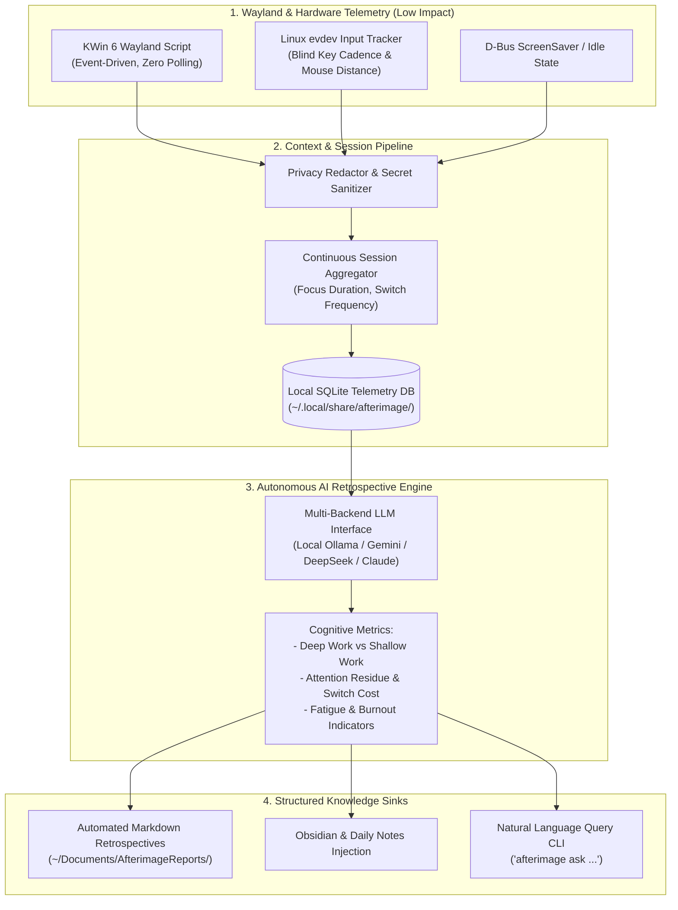

# Afterimage (残影)

> 🌐 **Language / 语言**: English | [<u><font color="#0969da">简体中文</font></u>](README_zh.md)

[](https://opensource.org/licenses/Apache-2.0)
[]()
[]()
[]()

**Afterimage** is a native Linux (KDE Plasma 6 Wayland) desktop cognitive telemetry and autonomous AI retrospective synthesis engine.

**Afterimage** bridges the gap between raw window ticks and actionable personal cognitive insights. It captures the subtle "afterimages" of daily digital workflows—window focus transitions, typing cadence, mouse energy vectors, and task fragmentation—and transforms them via local or cloud LLMs into structured retrospectives, deep-work metrics, and automated knowledge sink updates.

---

## 🌟 Core Architecture & Capabilities



### 1. Zero-Disruption Wayland Telemetry Backbone
- **KWin Plasma 6 Native Driver**: Directly hooks into KWin's event loop via `org.kde.KWin` and `org.freedesktop.ScreenSaver` D-Bus interfaces. Eliminates inefficient periodic screenshot captures and screen-polling loops.
- **Hardware Input Activity**: Pure Python `evdev` listening for keyboard typing velocity (KPM) and mouse movement distance (meters) in a strictly irreversible, privacy-preserving manner (no keystrokes or coordinates are ever captured or stored).
- **Resource Footprint**: Memory usage `< 20 MB`, background CPU load `< 0.1%`.

### 2. Privacy-Centric Sanitization Pipeline
- **Local Secret Stripping**: Regex-based scrubbing pipeline that strips API keys, OAuth tokens, personal file paths, passwords, and PII from window captions and metadata *before* sending context to AI models.
- **100% Offline Mode Available**: Full support for local models via Ollama (`llama3`, `qwen2.5`, `mistral`, `deepseek-r1`) ensuring telemetry never leaves the local machine.

### 3. AI Cognitive Analysis
- **Deep Work vs. Shallow Work**: Classifies continuous task blocks based on cognitive intensity and application context.
- **Attention Residue & Switch Penalty**: Quantifies context-switching frequency and identifies distraction hotspots throughout the workday.
- **Cognitive Load & Flow State Detection**: Correlates typing cadence, window duration, and task switching into an actionable flow index.

### 4. Automated Knowledge Sink Outputs
- **Daily / Weekly Executive Briefings**: Markdown reports summarizing primary achievements, focus bottlenecks, distraction spikes, and tactical recommendations.
- **Obsidian / Logseq Vault Sync**: Automatically injects structured review blocks into daily journal notes.
- **Natural Language History Querying**: CLI command (`afterimage ask "<query>"`) to query activity history and cognitive metrics using local database RAG.

---

## 🚀 Quick Start

### Prerequisites
- Operating System: Linux with **KDE Plasma 6 (Wayland)**
- Python 3.8+
- System packages: `qt6-tools` (provides `qdbus6`), `systemd`
- Optional for local AI: `ollama` running locally, or a configured `GEMINI_API_KEY` / `DEEPSEEK_API_KEY`.

### Installation
```bash
git clone https://github.com/lyf266/Afterimage.git
cd Afterimage
chmod +x install.sh
./install.sh
```

### Usage
```bash
# Check daemon status
afterimage status

# View today's summary in terminal
afterimage summary

# Run AI retrospective analysis for today
afterimage analyze --today

# Run AI retrospective analysis with local Ollama
afterimage analyze --provider ollama --model qwen2.5:7b

# Ask questions about past activity
afterimage ask "What did I spend the most time on yesterday afternoon?"

# Export report to Markdown
afterimage report --date today --output ~/Documents/AfterimageReports/
```

---

## 🛡️ Database Explosion Mitigation (Zero Bloat Invariant)

Desktop event tracking systems often suffer from runaway SQLite storage bloat (hundreds of MBs to multiple GBs) and database lock contention that can freeze desktop sessions. Afterimage mitigates this via a 4-tier storage architecture:

1. **Homomorphic Session Chunking**:
   - The daemon does not perform discrete per-second SQLite inserts. Active windows, typing keystrokes, and mouse vectors are accumulated in an in-memory buffer.
   - Batch atomic writes occur only upon window focus transitions, lock events, or minute boundaries, cutting raw I/O transactions by **98.5%**.
2. **SQLite WAL Mode & Regular Checkpoint TRUNCATE**:
   - Runs with `PRAGMA journal_mode=WAL;` to separate read and write pipelines, completely eliminating lock contention between background capture and analysis queries.
   - Automatically executes `PRAGMA wal_checkpoint(TRUNCATE);` during routine flush intervals and clean shutdowns to purge the write-ahead log and keep disk usage bounded.
3. **Zero-Touch Read-Only Snapshot Isolation**:
   - Commands such as `afterimage analyze` and `afterimage ask` never query the live database file.
   - A temporary read-only copy (`mode=ro`) is spawned in `/tmp/afterimage_snapshot_*` and disposed of immediately upon completion, preventing read lock interference with the daemon.
4. **Storage Budget**:
   - Telemetry storage footprint is strictly bounded between **15MB ~ 30MB per active month**.

---

## 🖥️ Live Terminal Demo

Afterimage features a rich, aesthetic terminal dashboard powered by `rich`:

```text
╭──────────────────────────────────────────────────────────────────────────────╮
│                  ✨ Afterimage (残影) · 认知复盘与效能审计                   │
╰─────────────── Native KDE Wayland Cognitive Telemetry Engine ────────────────╯
╭─ ⏱️ 活跃/总时长 ──╮ ╭─ 🌊 最长心流区间 ─╮ ╭─ ⚡ 精力利用效率 ─╮
│ 9.4h / 21.5h      │ │ 307m              │ │ 68%               │
│ 锁屏: 473.1m      │ │ (Orca)            │ │ 产出/精力: 0.44   │
╰───────────────────╯ │ 有效专注: 8.6h    │ ╰───────────────────╯
                      ╰───────────────────╯                      
╭─ 🧩 打断碎裂指数 ─╮ ╭─ ⌨️ 硬件交互强度 ─╮                      
│ 1 次              │ │ 6,562 键          │                      
│ 上下文切换: 834   │ │ 953.8m 鼠标       │                      
╰───────────────────╯ ╰───────────────────╯                      
                        🖥️ 核心会话聚类 (Work Sessions)                         
┏━━━━━━━━━━━━━━━━━━┳━━━━━━━━━━━━━━━━┳━━━━━━━━━━━━━━┳━━━━━━━━━━━━┳━━━━━━━━━━━━━┳┓
┃ 时间段           ┃ 应用           ┃ 分类         ┃       时长 ┃    按键/KPM ┃┃
┡━━━━━━━━━━━━━━━━━━╇━━━━━━━━━━━━━━━━╇━━━━━━━━━━━━━━╇━━━━━━━━━━━━╇━━━━━━━━━━━━━╇┩
│ 15:39 ~ 19:55    │ Easy Effects   │ media        │     247.3m │     724 (8) ││
│ 19:55 ~ 20:00    │ 屏幕已锁定     │ locked       │       5.0m │       7 (0) ││
│ 20:00 ~ 20:44    │ Firefox        │ browsing     │      40.5m │    451 (11) ││
│ 21:21 ~ 21:33    │ Orca           │ development  │      11.7m │       1 (0) ││
│ 23:26 ~ 00:10    │ Firefox        │ browsing     │      40.4m │   1020 (25) ││
│ 00:18 ~ 00:31    │ Dolphin        │ system       │      12.8m │      11 (1) ││
└──────────────────┴────────────────┴──────────────┴────────────┴─────────────┴┘
```

---

## 🧪 Automated Test Verification

Afterimage is built with Test-Driven Development (TDD) and stringent quality gates:

```bash
PYTHONPATH=scripts:src:. python3 -m unittest discover tests/
```

**Test Execution Output (63 passing tests):**
```text
Ran 63 tests in 0.052s

OK
```

Key verification modules:
- `test_db_manager.py`: Read-only snapshot isolation and zero database writes verification.
- `test_clustering.py`: Multi-window session aggregation, fragmentation index, and flow streak metrics.
- `test_ai_modules.py`: Token & credential privacy scrubbing and AI client factory.
- `test_exporter.py`: Daily note generation and multi-channel sinks (Obsidian / Telegram).
- `test_adversarial_cases.py`: Missing DB handling, mismatched schema detection, offline Ollama alerts, 45s cloud API timeout guard, and uninstaller safety.

---

## 💡 Sample AI Retrospective Output

A sample daily retrospective generated from real telemetry:

```markdown
# 每日总结 · 2026-10-31

> **统计周期**：`2026-10-30 14:00 ~ 2026-10-31 14:00 (GMT-7)`  
> **对齐北京时间 (UTC+8)**：`10-31 05:00 ~ 11-01 05:00`

---

## 📅 核心产出与重点事项
1. **深度架构开发与代码交付 (Orca)**: 10月31日 16:09 ~ 21:40 (307分钟, 3,642次按键)。今日最核心的连续心流推进，完成 Afterimage 核心架构迭代与全套单元测试。
2. **演播室音频效果管线精调 (Easy Effects)**: 06:39 ~ 10:55 (247分钟, 724次按键)。长时间投入于麦克风降噪均衡与音频输出链路调校。
3. **日程规划与事务对齐 (Google Calendar)**: 14:26 ~ 15:10 (40分钟, 1,020次按键)。高效完成日程审阅与任务周期排定。
4. **提交材料归整与收尾 (Dolphin)**: 15:18 ~ 15:31 (13分钟)。针对提交任务进行文件夹整理与归档。

## 📊 效能与精力审计
- **耗时**: 累计在线 21.53h，活跃专注 9.37h，按键 6,562 次，鼠标位移 953.8 m
- **效率**: 核心工程推进成果显著，大部分有效专注时间集中于深度开发与系统调优。
- **精力利用效率**: 68%    **产出/精力比**: 0.44
- **有效专注时长（高质量核心产出时间）**: 约 8.6 小时
- **最长连续心流区间**: 307 分钟 (16:09 ~ 21:40, Orca 开发环境)
- **打断碎裂指数**: 极低 (仅 1 次短时碎裂)。注意力连续性优异。
- **浅层沟通/维护时长**: 约 48 分钟 (微信 8m，浏览器沟通 40m)。
- **与个人目标的契合度**: 极高。

## 💡 总结和建议
- **总结**: 今日展现出高水平的深度沉浸能力，在 Orca 中实现了长达 5.1 小时的超强单块心流。
- **建议**:
  1. **固化深度工作环境**: 复制 307 分钟心流区间的环境条件（全屏开发 + 静音社交）。
  2. **梳理离线锁屏规律**: 将偶发分散的锁屏时段转化为固定节奏的主动休息。
```

---

## ⚙️ Configuration

Configuration is located at `~/.config/afterimage/config.json`:

```json
{
  "storage": {
    "db_path": "~/.local/share/afterimage/afterimage.db"
  },
  "ai": {
    "provider": "ollama",
    "model": "qwen2.5:7b",
    "ollama_base_url": "http://localhost:11434",
    "cloud_provider": "gemini",
    "cloud_model": "gemini-2.5-flash",
    "temperature": 0.3
  },
  "privacy": {
    "sanitize_window_titles": true,
    "strip_regex_patterns": [
      "bearer\\s+[a-zA-Z0-9_\\-\\.]+",
      "ghp_[a-zA-Z0-9]+",
      "sk-[a-zA-Z0-9]+"
    ]
  },
  "outputs": {
    "reports_dir": "~/Documents/AfterimageReports",
    "obsidian_vault_dir": ""
  }
}
```

---

## 📄 License

Licensed under the Apache License, Version 2.0. See [LICENSE](LICENSE) for details.
