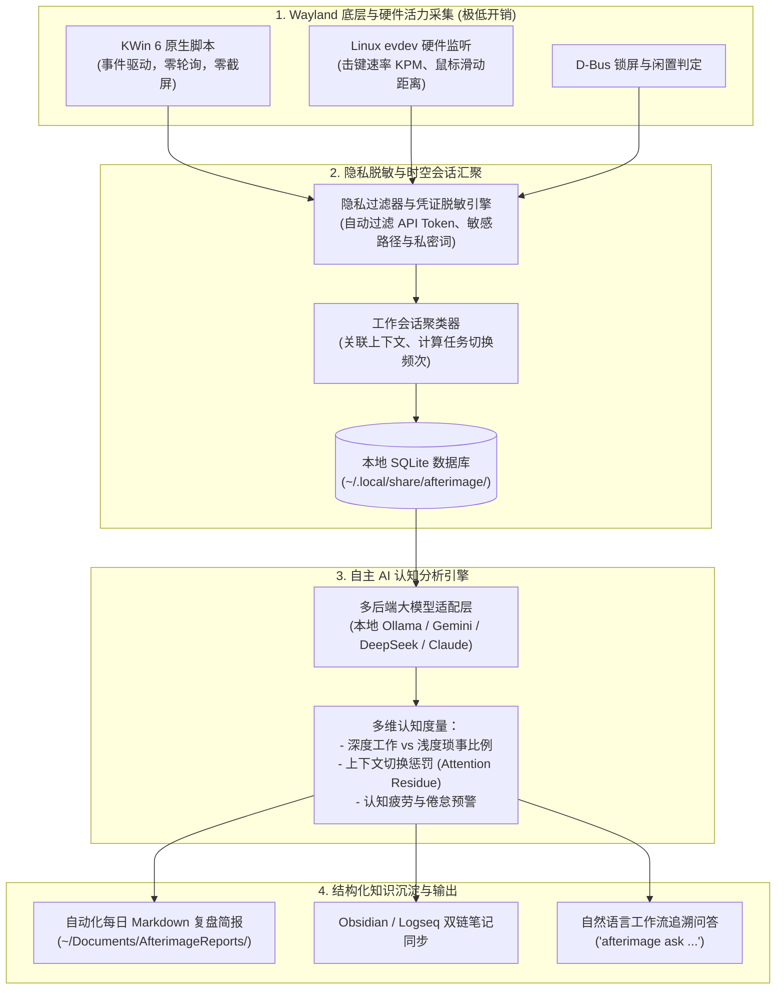

# Afterimage (残影)

> 🌐 **语言 / Language**: [<u><font color="#0969da">English</font></u>](README.md) | 简体中文

[](https://opensource.org/licenses/Apache-2.0)
[]()
[]()
[]()

**Afterimage（残影）** 是面向 Linux（KDE Plasma 6 Wayland）的原生桌面认知轨迹追踪与自主 AI 复盘分析引擎。

项目打破传统时间统计工具仅输出生硬“时长数字”的局限，深度捕捉用户在数字工作台留下的“操作残影”——活动窗口切换、持续专注时长、硬件按键节奏、鼠标轨迹活力以及多任务被打断的碎片分布，并通过本地或云端大模型（LLM）进行智能会话聚类、心流状态评估、注意力残留损耗审计与自动化多模态复盘报告沉淀。

---

## 🌟 核心架构与设计哲学



### 1. 零打扰 Wayland 底层采集
- **KWin 原生事件驱动**：直接注入 KDE Plasma 6 的 KWin 脚本运行时，基于 `org.kde.KWin` 与 `org.freedesktop.ScreenSaver` D-Bus 信号触发，杜绝传统低效的高频屏幕截屏与轮询占用。
- **不可逆键鼠活力度量**：利用 Linux `evdev` 硬件事件流，统计打字速率（KPM）、鼠标滑动距离（米）及点击频次，绝对盲计数、不记录键码、不记录坐标，保障隐私。
- **极致轻量**：守护进程常驻内存 `< 20 MB`，日常 CPU 占用率 `< 0.1%`。

### 2. 隐私优先与多级脱敏管道
- **本地敏感信息过滤**：在活动窗口标题或元数据输入大模型之前，通过内置正则过滤管道自动剔除 API Key、OAuth Token、系统绝对路径与私密关键词。
- **支持 100% 本地纯离线推理**：无缝对接本地 Ollama（如 `qwen2.5:7b`, `llama3`, `deepseek-r1`），所有数据与提示词全程不出本机内网。

### 3. AI 认知与专注度建模
- **深度工作（Deep Work）智能分级**：依据持续使用时长、键鼠活力密度及应用程序语义，区分心流创造时间与琐碎沟通时间。
- **注意力残留（Attention Residue）与切换损耗审计**：量化跨任务频繁切换带来的认知损耗，标注全天被打断的高发时段。
- **任务目标对齐**：对比预设目标或日常习惯，指出时间黑洞与偏离轨迹。

### 4. 多渠道结构化输出
- **每日/每周 AI 洞察简报**：生成结构清晰的 Markdown 日报，包含核心成果、阻碍分析、分心源诊断及次日改进建议。
- **Obsidian / Logseq 本地笔记生态集成**：自动将复盘卡片同步至每日日记（Daily Notes）。
- **自然语言历史追溯（CLI RAG）**：通过命令行执行问答（如 `afterimage ask "上周三下午我主要忙了哪些任务？"`），精准检索历史轨迹。

---

## 🚀 快速上手

### 环境依赖
- 操作系统：Linux，运行 **KDE Plasma 6 (Wayland)**
- Python 3.8+
- 系统组件：`qt6-tools`（提供 `qdbus6` 命令）、`systemd`
- AI 推理支持（任选其一）：
  - 本地运行的 `ollama`（推荐 `qwen2.5`）
  - 云端 API 密钥：`GEMINI_API_KEY`、`DEEPSEEK_API_KEY` 或 `OPENAI_API_KEY`

### 安装部署
```bash
git clone https://github.com/lyf266/Afterimage.git
cd Afterimage
chmod +x install.sh
./install.sh
```

### 常用命令
```bash
# 查看守护进程运行状态
afterimage status

# 在终端查看今日时间统计看板
afterimage summary

# 触发 AI 对今日工作轨迹进行智能复盘
afterimage analyze --today

# 指定使用本地 Ollama 驱动分析
afterimage analyze --provider ollama --model qwen2.5:7b

# 自然语言追溯历史工作细节
afterimage ask "昨天下午我主要在处理什么，注意力集中程度如何？"

# 导出格式化复盘报告至 Markdown
afterimage report --date today --output ~/Documents/AfterimageReports/
```

---

## ⚙️ 配置文件说明

配置文件默认位于 `~/.config/afterimage/config.json`：

```json
{
  "storage": {
    "db_path": "~/.local/share/afterimage/afterimage.db"
  },
  "ai": {
    "provider": "ollama",
    "model": "qwen2.5:7b",
    "ollama_base_url": "http://localhost:11434",
    "cloud_provider": "gemini",
    "cloud_model": "gemini-2.5-flash",
    "temperature": 0.3
  },
  "privacy": {
    "sanitize_window_titles": true,
    "strip_regex_patterns": [
      "bearer\\s+[a-zA-Z0-9_\\-\\.]+",
      "ghp_[a-zA-Z0-9]+",
      "sk-[a-zA-Z0-9]+"
    ]
  },
  "outputs": {
    "reports_dir": "~/Documents/AfterimageReports",
    "obsidian_vault_dir": ""
  }
}
```

---

## 📄 开源许可证

本项目基于 Apache License 2.0 许可证开源，详情参阅 [LICENSE](LICENSE)。
