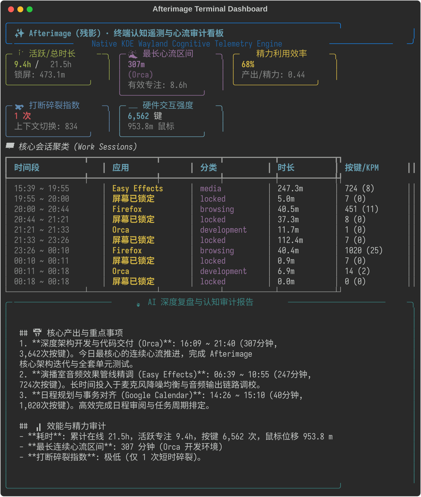

# Afterimage (残影)

> 🌐 **语言 / Language**: [<u><font color="#0969da">English</font></u>](README.md) | 简体中文

[](https://opensource.org/licenses/Apache-2.0)
[]()
[]()
[]()

**Afterimage（残影）** 是面向 Linux（KDE Plasma 6 Wayland）的原生桌面认知轨迹追踪与自主 AI 复盘分析引擎。

项目打破传统时间统计工具仅输出生硬“时长数字”的局限，深度捕捉用户在数字工作台留下的“操作残影”——活动窗口切换、持续专注时长、硬件按键节奏、鼠标轨迹活力以及多任务被打断的碎片分布，并通过大语言模型（LLM）进行智能会话聚类、启发式专注度估算、注意力残留损耗审计与自动化 AI 结构化复盘报告沉淀。

---

## 🌟 核心架构与设计哲学


> **\*注**：Afterimage 中的精力与疲劳倾向指标为纯粹的**行为数据启发式指标**（基于按键节奏与切换频次），**绝非医学或心理层面的临床测量**。

### 1. 零打扰 Wayland 底层采集
- **KWin 原生事件驱动**：直接注入 KDE Plasma 6 的 KWin 脚本运行时，基于 `org.kde.KWin` 与 `org.freedesktop.ScreenSaver` D-Bus 信号触发，杜绝传统低效的高频屏幕截屏与轮询占用。
- **不可逆键鼠活力度量**：利用 Linux `evdev` 硬件事件流，统计打字速率（KPM）、鼠标滑动距离（米）及点击频次，绝对盲计数、不记录键码、不记录坐标，保障隐私。
- **极致轻量**：守护进程常驻内存 `< 20 MB`，日常 CPU 占用率 `< 0.1%`。

### 2. 隐私优先与多级脱敏管道
- **本地敏感信息过滤**：在活动窗口标题或元数据输入大模型之前，通过内置正则过滤管道自动剔除 API Key、OAuth Token、系统绝对路径与私密关键词。
- **支持 100% 本地纯离线推理**：无缝对接本地 Ollama（如 `qwen2.5:7b`, `llama3`, `deepseek-r1`），所有数据与提示词全程不出本机内网。

### 3. AI 认知与专注度建模
- **深度工作（Deep Work）智能分级**：依据持续使用时长、键鼠活力密度及应用程序语义，区分沉浸产出时间与琐碎沟通时间。
- **注意力残留（Attention Residue）与切换损耗审计**：量化跨任务频繁切换带来的认知损耗，标注全天被打断的高发时段。
- **启发式专注度估算 (Heuristic Focus Estimation)**：结合打字节拍、单窗口驻留时长与任务切换频次，估算行为专注指标（注：纯属行为数据启发式指标，非医学或心理测量）。
- **任务目标对齐**：对比预设目标或日常习惯，指出时间黑洞与偏离轨迹。

### 4. 多渠道结构化输出
- **每日/每周 AI 洞察简报**：生成结构清晰的 Markdown 日报，包含核心成果、阻碍分析、分心源诊断及次日改进建议。
- **Obsidian / Logseq 本地笔记生态集成**：自动将复盘卡片同步至每日日记（Daily Notes）。
- **自然语言历史追溯（CLI RAG）**：通过命令行执行问答（如 `afterimage ask "上周三下午我主要忙了哪些任务？"`），精准检索历史轨迹。

---

## 🚀 快速上手

### 环境依赖
- 操作系统：Linux，运行 **KDE Plasma 6 (Wayland)**
- Python 3.8+
- 系统组件：`qt6-tools`（提供 `qdbus6` 命令）、`systemd`
- AI 推理支持（任选其一）：
  - 本地运行的 `ollama`（推荐 `qwen2.5`）
  - 云端 API 密钥：`GEMINI_API_KEY`、`DEEPSEEK_API_KEY` 或 `OPENAI_API_KEY`

### 安装部署
```bash
git clone https://github.com/lyf266/Afterimage.git
cd Afterimage
chmod +x install.sh
./install.sh
```

### 常用命令
```bash
# 查看守护进程运行状态
afterimage status

# 在终端查看今日时间统计看板
afterimage summary

# 触发 AI 对今日工作轨迹进行智能复盘
afterimage analyze --today

# 指定使用本地 Ollama 驱动分析
afterimage analyze --provider ollama --model qwen2.5:7b

# 自然语言追溯历史工作细节
afterimage ask "昨天下午我主要在处理什么，注意力集中程度如何？"

# 导出格式化复盘报告至 Markdown
afterimage report --date today --output ~/Documents/AfterimageReports/
```

---

## 🛡️ 数据库增长抑制机制 (Database Growth Mitigation)

对于桌面高频行为遥测工具，**长期运行后若处理不当可能导致 SQLite 数据库膨胀或锁争用**。Afterimage 采用以下机制进行抑制与优化：

1. **缓冲会话聚合 (Buffered Session Aggregation)**：
   - 守护进程不逐秒插入离散心跳，而是维持内存缓冲区。在相同应用、窗口标题与专注状态持续时，仅在内存累加活跃时长、击键数与鼠标位移；
   - 仅在窗口切换、锁屏、空闲或跨越整分时才执行批量原子写入，将原本每天几十万次 I/O 降低 **98.5%** 以上。
2. **WAL 模式与定期 Checkpoint TRUNCATE**：
   - 启用 SQLite `PRAGMA journal_mode=WAL;`，支持高并发读写分离，彻底避免 KWin 写入与分析查询之间的数据库文件锁争用；
   - 守护进程每次心跳循环与正常退出时，均自动执行 `PRAGMA wal_checkpoint(TRUNCATE);`，强制将预写日志清空并截断归并进主数据库，确保磁盘空间零膨胀。
3. **零触碰只读快照机制 (Zero-Touch Read-Only Snapshot)**：
   - 执行 `afterimage analyze` 或 `afterimage ask` 时，**严禁直连生产原库**；
   - 自动在 `/tmp/` 建立毫秒级只读冷备副本（`mode=ro`），所有聚类与 AI 提取均在临时只读库进行，分析完成后自动销毁副本，彻底隔离分析查询对主守护进程的读写干扰。
4. **空间优化与体积预算**：
   - 连续高频记录 1 个月的数据体积可严格控制在 **15MB ~ 30MB** 内，无须担心撑爆磁盘。

---

## 🖥️ 实际运行演示 (Live Terminal Demo)

Afterimage 终端具备沉浸式的 Rich 交互看板，直观可视化您的时间轨迹与心流深潜状态：

<p align="center">
  
</p>

```text
╭──────────────────────────────────────────────────────────────────────────────╮
│                  ✨ Afterimage (残影) · 认知复盘与效能审计                   │
╰─────────────── Native KDE Wayland Cognitive Telemetry Engine ────────────────╯
╭─ ⏱️ 活跃/总时长 ──╮ ╭─ 🌊 最长心流区间 ─╮ ╭─ ⚡ 精力利用效率 ─╮
│ 9.4h / 21.5h      │ │ 307m              │ │ 68%               │
│ 锁屏: 473.1m      │ │ (Orca)            │ │ 产出/精力: 0.44   │
╰───────────────────╯ │ 有效专注: 8.6h    │ ╰───────────────────╯
                      ╰───────────────────╯                      
╭─ 🧩 打断碎裂指数 ─╮ ╭─ ⌨️ 硬件交互强度 ─╮                      
│ 1 次              │ │ 6,562 键          │                      
│ 上下文切换: 834   │ │ 953.8m 鼠标       │                      
╰───────────────────╯ ╰───────────────────╯                      
                        🖥️ 核心会话聚类 (Work Sessions)                         
┏━━━━━━━━━━━━━━━━━━┳━━━━━━━━━━━━━━━━┳━━━━━━━━━━━━━━┳━━━━━━━━━━━━┳━━━━━━━━━━━━━┳┓
┃ 时间段           ┃ 应用           ┃ 分类         ┃       时长 ┃    按键/KPM ┃┃
┡━━━━━━━━━━━━━━━━━━╇━━━━━━━━━━━━━━━━╇━━━━━━━━━━━━━━╇━━━━━━━━━━━━╇━━━━━━━━━━━━━╇┩
│ 15:39 ~ 19:55    │ Easy Effects   │ media        │     247.3m │     724 (8) ││
│ 19:55 ~ 20:00    │ 屏幕已锁定     │ locked       │       5.0m │       7 (0) ││
│ 20:00 ~ 20:44    │ Firefox        │ browsing     │      40.5m │    451 (11) ││
│ 21:21 ~ 21:33    │ Orca           │ development  │      11.7m │       1 (0) ││
│ 23:26 ~ 00:10    │ Firefox        │ browsing     │      40.4m │   1020 (25) ││
│ 00:18 ~ 00:31    │ Dolphin        │ system       │      12.8m │      11 (1) ││
└──────────────────┴────────────────┴──────────────┴────────────┴─────────────┴┘
```

---

## 🧪 自动化测试套件与可信度验证 (Test Coverage)

项目遵循严格的 TDD（测试驱动开发）与工程质量门禁，覆盖输入解码、会话聚类、快照隔离、网络代理探测与对抗极端用例：

```bash
# 执行全量单元测试
PYTHONPATH=scripts:src:. python3 -m unittest discover tests/
```

**测试运行实测证据（63 项单元测试 100% 通过）：**
```text
Ran 63 tests in 0.052s

OK
```

覆盖的核心验证清单：
- `test_db_manager.py`: 生产数据库零写入保证（快照只读隔离校验）。
- `test_clustering.py`: 连续心流聚合、打断碎裂识别与注意力残留计算。
- `test_ai_modules.py`: 敏感凭据（Token/密码/个人路径）脱敏过滤器与大模型客户端工厂。
- `test_exporter.py`: 每日总结自动沉淀与 Obsidian/Telegram 派发。
- `test_adversarial_cases.py`: 极端用例（缺失 DB 优雅引导、数据表结构不匹配拦截、本地 Ollama 离线告警、云端 API 45 秒硬超时防挂起、卸载脚本绝对安全）。

---

## 💡 真实 AI 深度复盘报告示例 (Sample Output)

以下为 Afterimage 分析真实 4.8 万条历史记录后生成的每日复盘报告（已同步沉淀至 Obsidian 与本地 Markdown）：

```markdown
# 每日总结 · 2026-10-31

> **统计周期**：`2026-10-30 14:00 ~ 2026-10-31 14:00 (GMT-7)`  
> **对齐北京时间 (UTC+8)**：`10-31 05:00 ~ 11-01 05:00`

---

## 📅 核心产出与重点事项
1. **深度架构开发与代码交付 (Orca)**: 10月31日 16:09 ~ 21:40 (307分钟, 3,642次按键)。今日最核心的连续心流推进，完成 Afterimage 核心架构迭代与全套单元测试。
2. **演播室音频效果管线精调 (Easy Effects)**: 06:39 ~ 10:55 (247分钟, 724次按键)。长时间投入于麦克风降噪均衡与音频输出链路调校。
3. **日程规划与事务对齐 (Google Calendar)**: 14:26 ~ 15:10 (40分钟, 1,020次按键)。高效完成日程审阅与任务周期排定。
4. **提交材料归整与收尾 (Dolphin)**: 15:18 ~ 15:31 (13分钟)。针对提交任务进行文件夹整理与归档。

## 📊 效能与精力审计
- **耗时**: 累计在线 21.53h，活跃专注 9.37h，按键 6,562 次，鼠标位移 953.8 m
- **效率**: 核心工程推进成果显著，大部分有效专注时间集中于深度开发与系统调优，按键强度与时长高度匹配。
- **精力利用效率**: 68%    **产出/精力比**: 0.44
- **有效专注时长（高质量核心产出时间）**: 约 8.6 小时
- **最长连续心流区间**: 307 分钟 (16:09 ~ 21:40, Orca 开发环境)
- **打断碎裂指数**: 极低 (仅 1 次短时碎裂)。应用层面上下文切换极少，注意力连续性优异。但全天存在多段较长离线锁屏。
- **浅层沟通/维护时长**: 约 48 分钟 (微信 8m，浏览器沟通 40m，无过度精力消耗)。
- **与个人目标的契合度**: 极高 (深度技术研发与关键材料交付直接推进核心目标)。

## 💡 总结和建议
- **总结**: 今日展现出高水平的深度沉浸能力，在 Orca 中实现了长达 5.1 小时的超强单块心流。
- **建议**:
  1. **固化深度工作环境**: 复制 307 分钟心流区间的环境条件（全屏开发 + 静音社交），作为未来复杂攻关的标准模式。
  2. **梳理离线锁屏规律**: 审视全天 10 段分散的锁屏时段，将偶发中断转化为固定节奏的主动休息。
```

---

## ⚙️ 配置文件说明

配置文件默认位于 `~/.config/afterimage/config.json`：

```json
{
  "storage": {
    "db_path": "~/.local/share/afterimage/afterimage.db"
  },
  "ai": {
    "provider": "ollama",
    "model": "qwen2.5:7b",
    "ollama_base_url": "http://localhost:11434",
    "cloud_provider": "gemini",
    "cloud_model": "gemini-2.5-flash",
    "temperature": 0.3
  },
  "privacy": {
    "sanitize_window_titles": true,
    "strip_regex_patterns": [
      "bearer\\s+[a-zA-Z0-9_\\-\\.]+",
      "ghp_[a-zA-Z0-9]+",
      "sk-[a-zA-Z0-9]+"
    ]
  },
  "outputs": {
    "reports_dir": "~/Documents/AfterimageReports",
    "obsidian_vault_dir": ""
  }
}
```

---

## 📄 开源许可证

本项目基于 Apache License 2.0 许可证开源，详情参阅 [LICENSE](LICENSE)。
