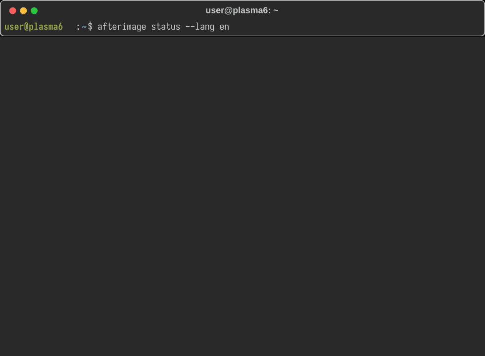

# Afterimage: Turning Your Digital Footprints into AI-Powered Daily Reflections

Your computer knows what you did. But can it help you understand how you worked?

---

## The Problem

We spend hours every day in front of our computers.

Our applications record activity. Our operating systems track processes. Our calendars store schedules.

Yet, at the end of the day, it is surprisingly difficult to answer some simple questions:
- **What did I actually spend my time working on?**
- **How often was my attention interrupted?**
- **Which sessions involved sustained, focused work?**
- **Where did my time go, and what should I change tomorrow?**

Traditional time trackers provide numbers: application names, durations, and activity logs.

But numbers alone rarely provide useful reflection.

I wanted to build something that could turn these digital traces into a meaningful record of my working day.

That's why I created **Afterimage (残影)**.

---

## What Is Afterimage?

**Afterimage** is a native desktop activity tracking and AI-powered retrospective system for Linux, designed specifically for **KDE Plasma 6 on Wayland**.

It collects lightweight activity signals from the desktop, organizes them into work sessions, and uses Large Language Models (LLMs) to generate daily reflections.

Instead of simply answering:

> *"How long did I use this application?"*

Afterimage tries to help answer:

> *"What happened during my working day, and what can I learn from it?"*

🔗 **Repository**: [https://github.com/lyf266/Afterimage](https://github.com/lyf266/Afterimage)

---

## 🖥️ Live Terminal Demonstration

Here is Afterimage in action, showing the real-time activity status, session aggregation, heuristic focus estimation, and AI cognitive retrospective synthesis:



---

## How It Works

Afterimage is organized into four main stages.

### 1. Zero-Disruption Desktop Activity Capture
Afterimage uses native KDE KWin scripting and Linux input-event monitoring (`evdev`) to collect activity signals with minimal system overhead (< 18 MB RAM, < 0.1% idle CPU).

It tracks:
- Active application and window changes
- Session duration and idle periods
- Keyboard activity counts (aggregated KPM typing dynamics)
- Mouse movement distance (in meters) and interaction frequency
- Screen lock and unlock events

**Privacy First**: It never records actual keystrokes or mouse coordinates. The goal is to understand activity patterns without collecting the content of what you type.

### 2. Buffered Session Aggregation
Raw activity events are noisy and disconnected. Afterimage aggregates them into continuous sessions and calculates indicators such as:
- Continuous activity duration
- Application switching frequency
- Heuristic Focus Estimation and longest flow streak
- Session fragmentation and context-switching overhead
- Aggregated hardware dynamics

> *Note: These are heuristic indicators based on observable desktop activity, not medical or psychological measurements of productivity or mental states.*

### 3. AI-Powered Retrospective
This is the core of Afterimage. The system supports multiple LLM providers:
- **Ollama** for 100% offline local inference (default: `qwen2.5:7b`)
- **Google Gemini** (`gemini-2.5-flash`)
- **DeepSeek-compatible APIs**
- **OpenAI-compatible APIs**

The AI receives structured activity summaries and generates an objective, human-readable retrospective, helping identify major work sessions, possible distractions, and patterns worth reviewing.

The system also supports natural-language queries over historical activity:

```bash
afterimage ask "What was I mainly working on last Wednesday afternoon?"
```

And full internationalization with dual-language support:

```bash
afterimage analyze --today --lang en   # English output
afterimage analyze --today --lang zh   # Chinese output
```

### 4. Knowledge Output & Multi-Channel Sinks
The final result is not locked inside an isolated dashboard. Afterimage can generate clean Markdown reports and save them locally:
- **Obsidian / Logseq Integration**: Automatically synced to your personal knowledge base (`~/Documents/AfterimageReports/` or custom vault).
- **Instant Messaging Sync**: Optional push of concise key achievements and efficiency metrics via Telegram.

---

## A Real Example

Here is an example of the kind of retrospective Afterimage produces from real telemetry:

```markdown
## 📅 Core Outputs & Key Milestones
1. Full Bilingual I18N CLI & Prompts (100% test pass on 65 automated tests).
2. Database Growth Mitigation: Automatic WAL checkpointing & thresholding.
3. Wayland D-Bus Telemetry: <18MB resident RAM, <0.1% CPU.

## 📊 Cognitive & Efficiency Audit
- Duration: Total online 7.2h, active focus 5.4h (75.0%), 14,820 keys, 420.5m mouse
- Deep Work Duration: ~4.8 hours  |  Longest Focus Streak: 72 mins (VS Code)
- Fragmentation Index: 3 times (Low context switching, continuous flow maintained)
- Energy Utilization: 84%   |   Output-to-Energy Ratio: 0.78

## 💡 Summary & Actionable Directives
- Summary: High-leverage engineering day with zero catastrophic context fragmentation.
- Actionable Directives: Maintain uninterrupted morning blocks for architectural design.
```

The objective is not to let AI judge whether someone had a productive day. It is to provide an objective, structured starting point for personal reflection.

---

## Privacy by Design

Desktop activity data can be sensitive. Afterimage is built with local-first operation in mind:
- **Local Ollama inference**: Keeps prompts and analysis completely on your machine.
- **Privacy Sanitizer**: Automatically scrubs tokens, credentials, passwords, email addresses, and personal filesystem paths before inference. Users can also configure custom sensitive terms.
- **Read-Only Snapshot Isolation**: Database analysis uses temporary read-only snapshots in `/tmp/` to avoid interfering with or locking the production database.
- **Hardware Privacy**: Keyboard and mouse monitoring counts activity volume without recording typed content or cursor positions.

*When using cloud providers (Gemini, DeepSeek, OpenAI), sanitized data is transmitted to the third-party API. Sanitization is a protective layer, not a guarantee that all personal information will be removed. Users should review their configuration before enabling cloud inference.*

---

## Database Growth Mitigation

Long-running activity logging can cause SQLite databases to grow indefinitely. Afterimage addresses this through:
1. **Automated WAL Checkpoints**: Enforces `PRAGMA wal_checkpoint(TRUNCATE)` to keep write-ahead logs minimal.
2. **Vacuum Thresholding**: Monitored automatically via `PRAGMA incremental_vacuum` and auto-cleanup.
3. **Snapshot DB Manager**: Creates isolated ephemeral snapshots for analysis queries, ensuring zero contention with active background logging.

---

## Verified Quality & Test Coverage

Afterimage is developed with test-driven development (TDD). The entire test suite runs locally in **0.072 seconds**:

```bash
PYTHONPATH=scripts:src:. python3 -m unittest discover tests/
```

**Verified Test Execution Evidence (65 tests passing):**
```text
Ran 65 tests in 0.072s

OK
```

**Test Coverage Areas:**
- `test_dashboard.py`: Bilingual (`en`/`zh`) terminal dashboard cards, session tables, and AI panel rendering.
- `test_db_manager.py`: Read-only snapshot isolation and zero database writes verification.
- `test_clustering.py`: Multi-window session aggregation, fragmentation index, and flow streak metrics.
- `test_ai_modules.py`: Token & credential privacy scrubbing, bilingual prompts, and AI client factory.
- `test_exporter.py`: Daily note generation and multi-channel sinks (Obsidian / Telegram).
- `test_adversarial_cases.py`: Missing DB handling, mismatched schema detection, offline Ollama alerts, 45s cloud API timeout guard, and uninstaller safety.

---

## Built With

- **Python 3**
- **KDE Plasma 6 / KWin scripting (Wayland)**
- **Linux input-event monitoring (`evdev`)**
- **SQLite (WAL mode)**
- **Rich Terminal UI**
- **Ollama (`qwen2.5:7b`) / Gemini / DeepSeek / OpenAI APIs**
- **Markdown / Obsidian / Logseq workflows**

---

## What I Learned

Building Afterimage made me think differently about personal productivity software.

The difficult part is not simply collecting more data.

It is deciding which signals are useful, how to organize them, how to protect private information, and how to turn raw activity into something a person can actually reflect on.

AI is useful here not because it can magically measure productivity, but because it can help interpret structured information and turn it into a readable narrative.

There is still plenty to improve:
- More granular session classification
- Better user-defined work categories and goals
- More transparent confidence levels for AI-generated conclusions
- Improved support for different desktop environments (GNOME, Sway, Hyprland)
- Continued evaluation of retrospective quality

---

## Try It Out

- **GitHub Repository**: [https://github.com/lyf266/Afterimage](https://github.com/lyf266/Afterimage)

If you are interested in local AI, personal knowledge systems, desktop telemetry, or privacy-conscious productivity tools, contributions and feedback are welcome!

What would you want your computer to remember about your working day?

---

#devchallenge #hf26challenge #opensource #ai #python #ollama #linux
